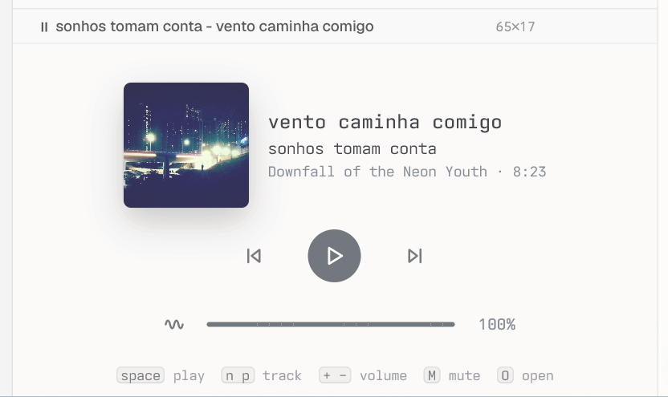
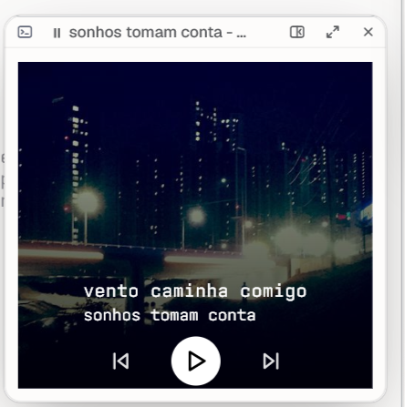

# NetEase for Tern

Control the [NetEase Cloud Music](https://music.163.com/) (网易云音乐) desktop app from
[Tern](https://stencil.so/tern). Windows and macOS show the song, artist and cover when
available. Both control playback and app volume. On macOS the controls work in the
background.
No account, login or API token is needed.

## Upstream and macOS backend

This standalone project is based on the [NetEase plugin in duzui300/tern-plugins](https://github.com/duzui300/tern-plugins/tree/main/plugins/netease), starting from [upstream commit `2d7c844`](https://github.com/duzui300/tern-plugins/tree/2d7c8443083bb6c0e07f3a5e8d73c427c28960ce/plugins/netease). The player interface and Windows backend come from that project.

This repository adds a Swift backend for macOS. It controls playback and NetEase's app volume in the background, and uses the active track ID to display the song, artist and album art. The backend uses available controls and metadata without checking the NetEase client version. The original copyright notice is preserved in [LICENSE](LICENSE).

The screenshots below are from the upstream Windows player.

<p align="center">
  
  &nbsp;&nbsp;
  
</p>

## Install

### Windows

```sh
tern plugin install github.com/haoyang1994/tern-netease-music
tern plugin reload netease
```

### macOS

Build from a checkout containing this version with the Xcode command line tools. Run
these commands from the repository root. The package contains a native executable for
the build machine's architecture. Tern runs it directly. Use Node.js 22.13 or newer
for track metadata and cover art. The plugin checks Tern's PATH and the standard
Homebrew locations.

```sh
build_dir=$(mktemp -d "${TMPDIR:-/tmp}/tern-netease.XXXXXX")
sh helpers/macos/build.sh "$build_dir/netease"
helper="$build_dir/netease/helpers/macos/netease-helper"
"$helper" status
```

An existing installed copy can be replaced with the following commands. Use
`tern plugin link "$build_dir/netease"` for development and keep the directory while
it is linked.

```sh
tern plugin list
tern plugin dir
tern plugin install "$build_dir/netease" --force
tern plugin reload netease
tern plugin list
```

The helper needs macOS Accessibility (辅助功能) permission in the context that starts
it. It checks access without displaying a permission dialog. `status` reports permission
and target availability for the terminal invocation. For a helper started by Tern,
check the player or the `problem` field in `state.txt` as well.

### Player

Run **NetEase: Open player** from the palette. The block opens as an always-on-top
picture in picture. Move the pointer over it to see the track and controls.

## Controls

With the player focused:

| Key | Action |
| --- | --- |
| `space`, `k` | Play / pause |
| `n`, `.` | Next track |
| `p`, `,` | Previous track |
| `+`, `-` | Volume ±5% on Windows, one NetEase volume step on macOS |
| `m` | Mute (Windows) |
| `o` | Open the NetEase window (Windows) |

Play/pause, next and previous are also palette commands under **NetEase**. On macOS,
**Increase volume** and **Decrease volume** are available there too. NetEase must
already be running in the background for these commands.

## How it works

### Windows

- **Now playing** — the title of the client's shell window (`OrpheusBrowserHost`) is
  `<song> - <artist>`. The helper reads it as the track.
- **Playing or paused** — the peak of the app's own audio streams in the Windows mixer.
  The client keeps its session alive while paused but goes silent.
- **Transport** — the app's global hotkeys, `Ctrl+Alt+P` (play/pause), `Ctrl+Alt+Right`
  (next) and `Ctrl+Alt+Left` (previous). Enable them in the client's settings.
- **Volume and mute** — the app's own mixer session controls the app's volume.
- **Cover, album and length** — the public NetEase catalogue (`music.163.com` search and
  song detail) matched against the title and artist, cached for six hours.

The Windows helper is a hidden PowerShell process. It stops on its own about a minute
after the last Tern window closes.

### macOS

The Swift helper looks up `com.netease.163music` among running apps. It searches for a
playback group in the CEF accessibility tree using exact button titles and descriptions.
On clients that expose a native Controls menu, it can use exact menu items directly.
It sends `AXPress` to the selected element. An enabled Pause action means playback is
active. An enabled Play action means playback is paused. Play/pause is confirmed by
observing the opposite action after pressing the control.

The helper checks `NSWorkspace.frontmostApplication` and watches application activation
notifications around each press. It reports a foreground change as a failed background
check. Opening NetEase is disabled on macOS, including the legacy `open` queue command.

- **Now playing** — the helper uses public macOS APIs to check
  which `.uc!` paths the same-user NetEase process holds open in its
  `Caches/online_play_cache` directory. A single numeric track ID must agree across
  two samples. The helper reads only the paths from the OS. A read-only Node.js
  helper looks up that exact ID in NetEase's local SQLite catalogue first.
  If SQLite is unavailable or has no matching metadata, the helper checks the
  local `playingList` JSON file in the same storage directory (up to 8 MiB)
  for the exact track ID. Both lookups return the song, artist, album and duration.
- **Cover art** — the cover helper uses the matching track's album art on the
  NetEase HTTPS image CDN. It can fall back to the public song detail endpoint by
  track ID. Both requests use known NetEase hosts and reject redirects. The
  plugin sends no account data or history.
- **Volume** — `AXPress` invokes **Increase Volume** or **Decrease Volume** in
  NetEase's native Controls menu (`升高音量` / `降低音量`). The player shows
  **App volume unknown** because the background app exposes no verified absolute
  level. The commands affect only NetEase's volume.

The helper and Tern exchange `state.txt`, `lease` and `cmd/*.cmd` in the plugin's data
directory. The v1 state file reports the latest command ID in `ack` and its failure, if
any, in `error`. On macOS, `track_id` is empty while no unique ID is observable and
`can_volume_up` and `can_volume_down` report each menu action's availability. The
macOS helper exits once the lease is more than 45 seconds old.

## Limitations

- macOS control depends on which AX controls the running NetEase client exposes. A client
  version, locale or window state that hides them can leave controls unavailable.
- macOS shows **Unknown track** when a track has no eligible open online cache path,
  when multiple tracks have eligible paths, or when the exact ID lacks local metadata.
  This can happen during track changes, when playing a downloaded or local track, or
  when the client changes its cache layout.
- macOS does not expose an absolute volume slider or mute command in the plugin.
- Linux playback control is unavailable.
- Windows volume needs an audio session. Playback detection follows audio level, so a
  silent gap longer than 2.5 seconds can show as paused.
- Windows cover and album matching is textual. Remixes, covers and local files may show
  missing or mismatched metadata. The Windows title splits at the first ` - `.
- The player shows no playback position or seek bar.

## Development

```sh
tern plugin link .  # Windows source checkout
tern plugin reload netease
tern plugin list
```

On macOS, link the built package from the install steps. With NetEase already running,
queue at least three tracks for manual verification and leave another app in front.
The `verify` commands each perform one real playback action and print the foreground app
before and after, any activation events, and the observed playback state.

```sh
"$helper" status
"$helper" verify toggle
"$helper" verify toggle
"$helper" verify next
"$helper" verify previous
"$helper" verify volume-down
"$helper" verify volume-up
```

For a Tern input-focus check, use a separate offscreen instance with a private
`TERN_CONFIG_DIR`, daemon socket and control socket. Record the focused pane before and
after its transport and `plugin.netease.volume-up` / `plugin.netease.volume-down`
actions. Check the matching `ack` and `error` values in the isolated data folder.
For a metadata check on macOS, stream two different songs and check that `track_id`
and the displayed song and cover follow the transitions.

Run `sh tests/macos.sh` from the checkout to test the cache-path
selection, SQLite lookup, playing list fallback and cover URL checks with temporary fixtures.

Background AX behavior references [CloudMusicFocus's CEF investigation](https://github.com/eruimisshy/CloudMusicFocus/blob/main/Sources/NeteaseController.swift)
and [Background Music PR #853's direct menu action](https://github.com/kyleneideck/BackgroundMusic/pull/853).
